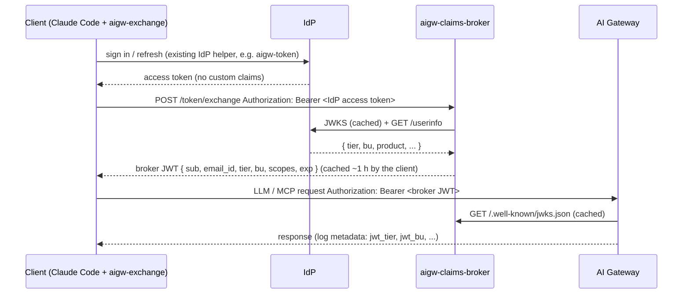

# aigw-oidc-claims-broker

A small token broker for the **Prisma AIRS AI Gateway** (Portkey enterprise gateway) for identity providers that
**don't put custom claims in the access token**.

Some IdPs only expose attributes such as `tier`, `bu`, `product` or `department` through **`/userinfo`** or the
**ID token**. The ID token is short-lived and often not re-issued when a client renews with a refresh token. The gateway
reads claims from the bearer JWT only, so those attributes reach it for the first few minutes after sign-in and then
disappear. Per-tier budgets, routing and guardrails that depend on them stop working mid-session.

The broker fixes this without changing the gateway:

1. The client (Claude Code via `aigw-exchange`, or any app) sends its **IdP access token** to the broker.
2. The broker **verifies** it against the IdP's JWKS (issuer, expiry, optional audience and client allow-list), calls the
   IdP's **`/userinfo`** with it, and copies the attributes you choose.
3. The broker **mints a short-lived JWT** with those attributes as flat claims, plus the gateway `scopes`, the user's
   email and any static defaults. It signs the token with its own key and publishes the key at `/.well-known/jwks.json`.
4. The client calls the gateway with the broker token. The gateway trusts the broker's JWKS URL and extracts the claims
   (SCM *Extract Claims*) into request metadata as `jwt_<claim>`.



The broker is called once per token lifetime, not per request. It is **not in the data path**.

> Community project, not an official Palo Alto Networks product. MIT licensed. Adapted from
> [thresh97/aigw-entra-jwt-broker](https://github.com/thresh97/aigw-entra-jwt-broker) (see *Credits*).

## Key assumption: `/userinfo` answers for refreshed tokens
The broker does not cache anything. On every exchange it asks the IdP's `/userinfo` **with the client's current access
token** (from sign-in or from any later refresh). Most IdPs build the userinfo response from the user's profile at that
moment, so the attributes come back even when the refreshed access token doesn't carry them. **Test this with your IdP
before deploying** (see *Verify your IdP*). If your IdP drops the attributes from `/userinfo` too after a refresh, the
broker refuses (`403 missing_required_claims`) instead of minting tokens without them; it can't fix that case.

The broker needs **no credentials at the IdP**: it verifies tokens with the IdP's public JWKS and calls `/userinfo` with
the user's own token. Its only secret is its own signing key. It's stateless: run as many replicas as you like behind a
load balancer (they share the key secret).

## When to use it (and when not)
| Situation | Use the broker? |
|---|---|
| The IdP can put the custom claims in the **access token** | **No.** Configure the IdP instead; the gateway reads them directly |
| Claims only in `/userinfo` or the ID token (and the ID token isn't refreshed) | **Yes** |
| You need claims combined from several sources, or renamed | Yes (`copy_claims` renames; userinfo first, then the access token) |
| Only a coarse grouping (e.g. one budget per team) | Maybe not: directory sync groups mapped to workspaces may be enough |

Don't solve this by having the client send the attributes as request headers (`x-portkey-metadata`): the user controls
the client, so they could choose their own tier. The broker reads them from the IdP, server-side.

## Lab validation (2026-11-19)
Keycloak client configured like the problem IdP (`tier`/`bu` only in the ID token and `/userinfo`; see
`examples/keycloak-lab-setup.sh`), broker on Kubernetes (2 replicas), hybrid AI Gateway 2.33.1:

| Test | Result |
|---|---|
| User with `user_tier`: IdP access token | no `tier`/`bu` (reproduces the problem) |
| Same token → broker | 200, minted JWT has `tier`, `bu`, `email_id`, `scopes`; 1 h, capped at the IdP token's expiry |
| **Refreshed** access token (refresh grant, no custom claims) → broker | `/userinfo` still returns them → 200 with `tier`/`bu`; gateway 200 |
| User without a tier | 403 `missing_required_claims: [tier]` (no claimless token is minted) |
| ID token, garbage, expired, wrong issuer/audience/client, `alg: none`, foreign signature | 401 / 403 |
| Raw IdP access token → gateway | 403 / error 033 (no gateway scope, no tier claim) |
| Broker token → gateway (2.33.1) | **200**, log metadata `auth_type: JWT`, user, **`jwt_tier: tier-3`** (each claim must be on SCM *Extract Claims*) |
| Broker JWKS via `*.svc.cluster.local` | 401 `No matching key found for kid` (SSRF block); via LoadBalancer IP: works |

Unit tests (`npm test`, Node 20+, no dependencies) cover the same cases with a stub IdP.

## Verify your IdP (5 minutes, before deploying)
```bash
ISSUER="https://idp.example.com/oauth2/default"
UI=$(curl -s "$ISSUER/.well-known/openid-configuration" | jq -r .userinfo_endpoint)
T1=$(<your IdP helper> token)                                     # token from a fresh sign-in
curl -s -H "Authorization: Bearer $T1" "$UI" | jq '{sub, tier, bu}'
T2=$(<force a refresh, e.g. AIGW_REFRESH_MARGIN=999999 aigw-token token>)   # token from the refresh grant
curl -s -H "Authorization: Bearer $T2" "$UI" | jq '{sub, tier, bu}'
```
Both calls must return your attributes. If only the first does, the broker can't recover them.

## Requirements
- An OIDC IdP with discovery (`/.well-known/openid-configuration`), a JWKS, signed **JWT** access tokens and a
  **`/userinfo`** endpoint that returns the attributes for the access token.
- A Prisma AIRS AI Gateway with **JWT authentication** on (hybrid: `JWT_ENABLED=ON` in Helm values), and SCM access
  to *AI Gateway → Admin Settings → Authentication* (JWKS URI list, Extract Claims).
- Somewhere to run a small Node 20+ service reachable by the clients and by the gateway pods: Kubernetes
  (`deploy/`), a container (`Dockerfile`), or any Node host.
- Clients that can run a token helper (Claude Code `apiKeyHelper`) or call the broker themselves.

## Deploy

### 1. Broker policy
Copy `examples/broker-config.example.json` and edit:
```json
{
  "issuer": "https://idp.example.com/oauth2/default",
  "allowed_clients": ["<cli-client-id>"],
  "copy_claims": { "tier": "tier", "bu": "bu", "product": "product", "component": "component" },
  "required_claims": ["tier"],
  "static_claims": { "scopes": ["completions.write", "mcp.invoke"] },
  "token_ttl_seconds": 3600
}
```
See *Configuration* for every field.

### 2. Run it on Kubernetes
```bash
cp deploy/config.env.example deploy/config.env      # set BROKER_ISSUER (public URL), EXPOSE, BROKER_CONFIG_FILE
./deploy/deploy.sh --dry-run                         # review
./deploy/deploy.sh                                   # namespace, signing key (generated in-cluster), ConfigMaps, Deployment, Service
```
The code is mounted from a ConfigMap into the stock `node:22-alpine` image (no build). The pods run as non-root with a
read-only file system, Pod Security `restricted`, 2 replicas (stateless). Put TLS in front (Ingress or LB) for
production and use that https URL as `BROKER_ISSUER`.

Other platforms: `docker build -t aigw-claims-broker broker/` and run it with the environment variables under *Configuration*.

### 3. Gateway (SCM)
*AI Gateway → Admin Settings → Authentication → JWT Authentication*:
- **JWKS URI**: add the broker's JWKS URL, comma-separated with the existing ones:
  `https://aigw-broker.example.com/.well-known/jwks.json`. The gateway pods fetch it, so it must be reachable from them.
  **Don't use a Kubernetes service name (`*.svc.cluster.local`)**: the gateway's SSRF protection blocks `cluster.local`
  names even when they're in `TRUSTED_CUSTOM_HOSTS`, and the only symptom is `No matching key found for kid` (lab,
  gateway 2.33.1). Use a LoadBalancer/Ingress address or a public HTTPS URL.
- **Extract Claims**: add the claims to log and use (`tier`, `bu`, …). Metadata prefix `jwt_` gives `metadata.jwt_tier`.
- Optional: remove the IdP's own JWKS URL once every client uses the broker, so raw IdP tokens (without the attributes)
  are rejected instead of being accepted without them.

### 4. Client: Claude Code
Install `client/aigw-exchange` (bash, curl, jq) next to your IdP token helper (for example `aigw-token` from
[aigw-claude-code-okta-jwt](https://github.com/djspears/aigw-claude-code-okta-jwt)), then in `~/.claude/settings.json`
(or managed settings):
```json
{
  "apiKeyHelper": "/usr/local/bin/aigw-exchange",
  "env": {
    "ANTHROPIC_BASE_URL": "https://<gateway-host>",
    "ANTHROPIC_CUSTOM_HEADERS": "x-portkey-config: <config-id>",
    "AIGW_BROKER_URL": "https://aigw-broker.example.com",
    "AIGW_IDP_TOKEN_CMD": "/usr/local/bin/aigw-token",
    "AIGW_AUTH_MODE": "device",
    "OIDC_ISSUER": "https://idp.example.com/oauth2/default",
    "OIDC_CLIENT_ID": "<cli-client-id>",
    "OIDC_SCOPE": "openid offline_access"
  }
}
```
`aigw-exchange` runs the IdP helper (which handles sign-in and refresh), exchanges the access token, and caches the
broker token until two minutes before it expires. `aigw-exchange status` shows the cached claims; `aigw-exchange clear`
forces a new exchange. Don't set `ANTHROPIC_API_KEY` or `ANTHROPIC_AUTH_TOKEN`: they override the helper.

Other clients: `POST <broker>/token/exchange` with `Authorization: Bearer <IdP access token>`; use the returned
`access_token` as the gateway bearer token (or `x-portkey-api-key`) until `expires_in`.

### 5. Verify
```bash
aigw-exchange status          # tier, bu, email_id, scopes, expires_in
```
Send a request, then check the gateway log entry: `auth_type: JWT`, your user, and `jwt_tier` / `jwt_bu` in Metadata,
on every request, including after the IdP token has been refreshed.

## Configuration
Broker policy (JSON, `BROKER_CONFIG_FILE` or `BROKER_CONFIG_JSON`):

| Field | Default | Meaning |
|---|---|---|
| `issuer` | required | IdP issuer URL. Discovery must return the same issuer |
| `audience` | none | Accepted `aud` values of the IdP access token (recommended when the IdP sets one) |
| `allowed_clients` | none | Accepted client IDs (`azp` / `client_id` / `cid`). Recommended: your CLI/app client IDs |
| `algorithms` | `["RS256","ES256"]` | Accepted IdP signing algorithms (RS/PS/ES 256/384/512; `none` and HMAC never) |
| `userinfo` | `true` | Call `/userinfo`. `false`: copy from the access token only |
| `copy_claims` | `{}` | `{ "<output claim>": "<source claim>" }`; source looked up in userinfo, then the access token. Empty values are skipped |
| `required_claims` | `[]` | Output claims that must be present, else **403** and nothing is minted |
| `identity_claims` | `["email","preferred_username","upn"]` | First email-like value becomes `email_id` (the gateway's user identity) |
| `static_claims` | `{}` | Added to every token, e.g. `scopes`, `portkey_workspace`, `portkey_oid`, `defaults` |
| `token_ttl_seconds` | `3600` | Lifetime of minted tokens (60–86400) |
| `cap_to_upstream_exp` | `true` | Never outlive the IdP access token |

Reserved claims (`iss sub aud exp iat nbf jti`) are set by the broker. Use `scopes` (array), never `scope`: the gateway
reads `scope` first, and an OIDC-style `scope` (`openid email …`) would hide `scopes` (error 033).

Environment:

| Variable | Meaning |
|---|---|
| `BROKER_ISSUER` | Public base URL of the broker (`iss` of minted tokens) — required |
| `BROKER_AUDIENCE` | `aud` of minted tokens (default `aigw`) |
| `SIGNING_KEY_DIR` / `SIGNING_KEY_PEM` | PEM private key(s): RSA ≥ 2048 or EC P-256. All keys are published; the newest file signs |
| `ACTIVE_KID` | Pin the signing key by kid (RFC 7638 thumbprint) |
| `PORT` | Listen port (default 8080) |

Minted token example:
```json
{ "scopes": ["completions.write","mcp.invoke"], "tier": "t1", "bu": "ops", "email_id": "pat@example.com",
  "iss": "https://aigw-broker.example.com", "aud": "aigw", "sub": "<idp sub>", "iat": 1795100000, "exp": 1795103600,
  "jti": "…", "idp_iss": "https://idp.example.com/oauth2/default" }
```

## API
| Endpoint | |
|---|---|
| `POST /token/exchange` | `Authorization: Bearer <IdP access token>` → `200 {access_token, token_type, expires_in, issued_token_type}`; `401 invalid_token / userinfo_denied / missing_bearer_token`; `403 forbidden_client / missing_required_claims {missing}`; `502 idp_unavailable / userinfo_unavailable` |
| `GET /.well-known/jwks.json` | Broker public keys (cache 5 min) |
| `GET /.well-known/openid-configuration` | `issuer`, `jwks_uri`, `token_endpoint` |
| `GET /healthz` | Liveness |

## Security notes
- **Trust anchor:** the configured `issuer`. Discovery, JWKS and `/userinfo` come only from it, never from the token.
  Signature, `iss`, `exp`/`nbf` (30 s leeway), optional `aud` and client allow-list are checked before `/userinfo` is called.
- **Attributes come from the IdP, server-side.** Clients can't add or change claims. `required_claims` refuses users
  whose attributes are missing instead of minting a token without them.
- **Short-lived output**, capped at the IdP token's expiry; the client re-exchanges after IdP refresh. Revocation at
  the IdP takes effect at the next exchange (≤ `token_ttl_seconds`).
- **Signing key**: generated in the cluster by `deploy.sh`, mounted read-only, never logged. Rotate with
  `./deploy/deploy.sh --rotate-key` (old key stays in the JWKS until you remove it after one token lifetime).
  For stronger custody, sign with a KMS/HSM key (as the Entra/Key Vault broker this is adapted from does).
- **Logs** contain subject, client and claim names, never tokens or claim values.
- **Exposure:** `/token/exchange` only accepts valid IdP tokens, but put it behind TLS and, if needed, rate limiting at
  the ingress.
- The gateway trusts every key in its JWKS list: protect who can change *Admin Settings → Authentication*.

## Troubleshooting
| Symptom | Fix |
|---|---|
| `401 invalid_token` "issuer mismatch" | `issuer` must equal the token's `iss` exactly (scheme, host, path, trailing slash ignored) |
| `401 userinfo_denied` | The access token isn't accepted by `/userinfo` (missing `openid` scope, or an ID token was sent) |
| `403 missing_required_claims` | The user has no value for that attribute at the IdP, or the IdP doesn't release it to `/userinfo` for this client |
| `403 forbidden_client` | Add the token's `azp`/`client_id`/`cid` to `allowed_clients` |
| `502 idp_unavailable` | Broker can't reach the IdP discovery/JWKS (egress, DNS, TLS) |
| Gateway `401 … No matching key found for kid` | Broker JWKS URL not in SCM, not reachable from the gateway pods, or a `*.svc.cluster.local` URL (blocked by the gateway's SSRF protection): use a LoadBalancer/Ingress or public URL. Changes apply within a minute or two |
| Gateway `403 … Error Code: 033` | No gateway scope: add `scopes` in `static_claims` |
| `jwt_tier` missing from gateway logs | Add the claim to SCM **Extract Claims** |
| Pod `EACCES` reading `/keys` | Use the provided manifest (`fsGroup` + secret mode 0440) |

## Repository layout
```
broker/src/{server,broker,oidc,keys,config}.js   the broker (Node 20+, standard library only)
broker/test/                                     node:test suite with a stub IdP (npm test)
broker/Dockerfile                                container image (optional)
client/aigw-exchange                             Claude Code apiKeyHelper / CLI for the exchange
deploy/                                          Kubernetes templates + deploy.sh (key generation, rotation)
examples/                                        broker policy example, Keycloak lab setup
```

## Credits
Adapted from **[thresh97/aigw-entra-jwt-broker](https://github.com/thresh97/aigw-entra-jwt-broker)** (MIT, © 2026
thresh97): the token-exchange contract (`POST /token/exchange` with the IdP token as bearer), broker-signed gateway
JWTs verified through a published JWKS, and the broker staying out of the data path. This version targets any OIDC IdP
and **copies attributes from `/userinfo`** instead of mapping Entra app roles to a policy, signs with a local key instead
of Azure Key Vault, and has no runtime dependencies.

## License
[MIT](LICENSE)
